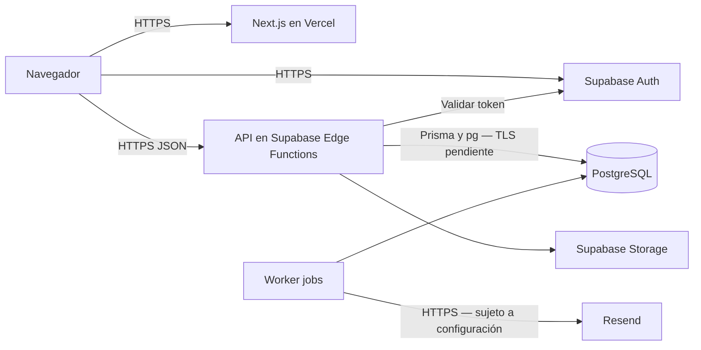

# Lowkey Saints

Tienda de ropa con catálogo, filtros, variantes, bolsa, pedidos mediante enlace WhatsApp y administración de inventario y finanzas. Desarrollo Web Integral, **10A BIS**, noviembre de 2026.

## Arquitectura real

Next.js 16.3.6 y React 19 presentan la interfaz. Una API REST en **Supabase Edge Functions**, escrita en TypeScript para Deno, utiliza Prisma 7 y PostgreSQL. Supabase proporciona Auth y Storage; el worker de reposición contiene integración con Resend. WhatsApp utiliza `wa.me`: no es WhatsApp Business API.



Frontend: **https://lowkey-saints.vercel.app**. El estado funcional se registra en [el informe](docs/seguridad-apis.md) y [las evidencias](docs/evidencias/seguridad-apis/README.md). Una publicación exitosa no demuestra todos los flujos.

## Equipo

| Integrante                       | Módulos                                        |
| -------------------------------- | ---------------------------------------------- |
| Adriana Colín Múñoz              | Landing, catálogo, filtros y Completa el look  |
| Manuel Alejandro Hernández Rubio | Ficha de producto, variantes y carrito lateral |
| Michelle Córdova Torres          | Administración, inventario y finanzas          |
| Diego Daher Díaz Contreras       | Pedidos WhatsApp, automatización y reposición  |

## Configurar y ejecutar

Copiar `.env.example` a `.env`, completar valores privados fuera de Git y ejecutar `npm ci` y `npm run dev`. La web abre en `http://localhost:3000`; requiere una API de Supabase configurada. Revisar destino y respaldo antes de ejecutar migraciones.

| Entorno              | Variables y responsabilidad                                                                                           |
| -------------------- | --------------------------------------------------------------------------------------------------------------------- |
| Next.js y Vercel     | `NEXT_PUBLIC_SUPABASE_URL`, `NEXT_PUBLIC_SUPABASE_PUBLISHABLE_KEY`. Configuración pública, sin acceso administrativo. |
| Edge Functions       | `APP_DATABASE_URL`, `ALLOWED_ORIGINS`, `RATE_LIMIT_SECRET`, `WHATSAPP_PHONE`. Secretos solo en servidor.              |
| Worker               | `JOB_SECRET`, `RESEND_API_KEY`, `RESEND_FROM`, `SITE_URL`. Revisar cola antes de habilitar correos.                   |
| Administración local | `DIRECT_URL`, `SUPABASE_ACCESS_TOKEN`, `SUPABASE_PROJECT_REF`; nunca incluirlos en el build del frontend.             |
| Integración local    | `TEST_DATABASE_URL` a una base local desechable; el script rechaza hosts remotos.                                     |

`.vercelignore` excluye `.env*`, documentación, copias de trabajo, clientes generados y scripts del paquete del frontend. Las dos variables públicas también quedaron configuradas en Production de Vercel para futuros despliegues; ver vercel-env.json.

## Pruebas

```bash
npm run test:unit
npm run check:edge
npm run check-types
npm run lint
npm run build
npm run test:integration
# Con npm run dev activo en otra terminal:
npm run test:browser
```

Las pruebas de navegador usan respuestas controladas para catálogo y pedidos. No equivalen a una compra en nube. Integración crea y elimina una base temporal únicamente en PostgreSQL local.

## Estado de la práctica

| Requisito                  | Estado                    | Evidencia                                                          | Pendiente                                         |
| -------------------------- | ------------------------- | ------------------------------------------------------------------ | ------------------------------------------------- |
| Diagnóstico y arquitectura | IMPLEMENTADO              | Código, diagrama y captura local                                   | Mantener documentación                            |
| Dos servicios web          | IMPLEMENTADO              | API propia 200 y Supabase Auth real; cloud.json                    | Catálogo remoto vacío                             |
| Autorización               | IMPLEMENTADO              | Finanzas: anónimo 401, ADMIN 200, STAFF 403                        | Ampliar cobertura                                 |
| Límite del cuerpo          | IMPLEMENTADO y publicado  | 30 pruebas; before-after.json; commit 1f8d450; backend-deploy.json | Ampliar pruebas HTTP locales                      |
| Frontend en Vercel         | IMPLEMENTADO y verificado | HTTP 200, CORS permitido, redirección y TLS; publication.json      | Catálogo remoto vacío                             |
| HTTPS Supabase             | IMPLEMENTADO y verificado | TLS 1.3; certificado validado                                      | Repetir control de vigencia                       |
| TLS PostgreSQL             | EN PROCESO                | Conexión probada sin TLS; falla de CA al verificar                 | Configurar CA y verificar ambos tramos del pooler |
| Integración local          | EN PROCESO                | ECONNREFUSED                                                       | Iniciar PostgreSQL local y repetir                |
| Word y exposición          | IMPLEMENTADO              | Informe, guion y documento en docs/entregables                     | Revisar conclusiones individuales                 |
| Cabeceras adicionales      | PROPUESTO                 | Sin configuración explícita en Next.js                             | Evaluar CSP y frame-ancestors                     |

La mejora limita JSON a **200 000 bytes** e imágenes a **5 242 880 bytes**, cancela el flujo al exceder el máximo y conserva el contrato de errores. Los límites exactos se aceptan; `Content-Length` no es la única comprobación.

## Orden para cerrar la práctica

1. Revisar informe y evidencias, distinguiendo código, pruebas locales y nube.
2. Completar TLS PostgreSQL con la CA oficial del proyecto; no usar `rejectUnauthorized: false`.
3. Mantener publicación de la API y CORS; revisar Auth y notificaciones por separado.
4. Iniciar PostgreSQL local y ejecutar integración.
5. Revisar las cuatro conclusiones propuestas y ensayar el guion de diez minutos.

[Arquitectura](docs/Arquitectura.md) · [Informe](docs/seguridad-apis.md) · [Evidencias](docs/evidencias/seguridad-apis/README.md) · [Word](docs/entregables/Lowkey_Saints_Seguridad_APIs_Despliegue.docx)

Repositorio: https://github.com/DiegoDaher/lowkey-saints
