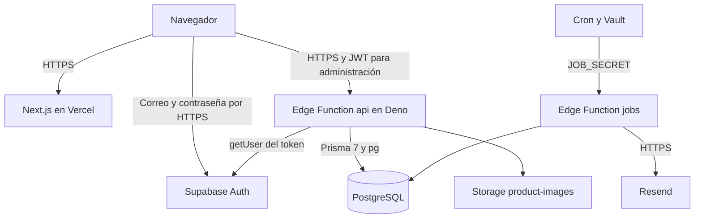

# Arquitectura de Lowkey Saints

La interfaz usa Next.js 16 App Router y React. Las páginas viven en `src/app`; los componentes implementan catálogo, ficha, bolsa y administración. `src/proxy.ts` redirige visitantes sin sesión al login. La autorización efectiva se realiza en la API.

`src/lib/api.ts` llama a `/functions/v1/api/v1` en Supabase. No hay Route Handlers de negocio en Next.js. `src/server/db/prisma.ts` reexporta el cliente HTTP; no conecta PostgreSQL. La estructura antigua descrita aquí no representaba el sistema y fue sustituida por este diagnóstico.

La API valida el token con Auth y consulta `AdminProfile.active` y `role`. ADMIN accede a finanzas y roles; STAFF opera catálogo, inventario y pedidos. El precio se calcula en servidor y las reservas se guardan en transacciones. RLS y permisos SQL aportan defensa adicional; Prisma no hereda automáticamente la identidad JWT del navegador.

El esquema está en `prisma/schema.prisma` y las tres migraciones en `prisma/migrations`. Las funciones comparten contratos Zod, servicio de negocio, lector acotado y notificaciones. El lector acepta hasta 200 000 bytes JSON o 5 MiB de imágenes, cancela el flujo al excederlos y genera `AppError(413)`.

`jobs` expira reservas y procesa la cola de reposición. El código integra Resend con reintentos e idempotencia; su existencia no demuestra entrega de correo. El enlace `wa.me` abre WhatsApp, sin enviar automáticamente un mensaje por Business API.

PostgreSQL requiere una comprobación TLS independiente. La conexión local probada con `APP_DATABASE_URL` no estaba cifrada; no se debe inferir el estado remoto de Edge sin medirlo. Configurar la CA del proyecto y validar conexión y nombre antes de declarar TLS completo.

El despliegue trata frontend, API, migraciones y worker por separado. Actualizar la API no requiere migraciones ni activar Cron. Ver [informe de seguridad](seguridad-apis.md).
