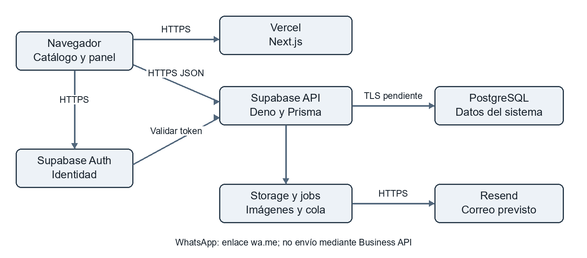
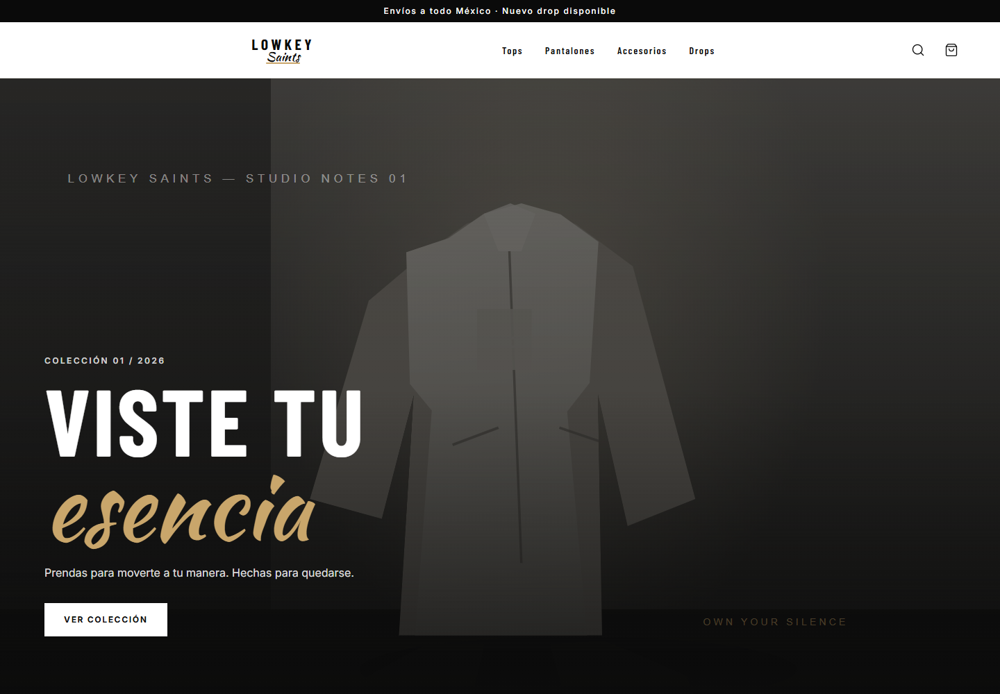

# Seguridad de APIs y despliegue de Lowkey Saints

Desarrollo Web Integral · Unidad III · 10A BIS · Noviembre de 2026

Proyecto Lowkey Saints

| Integrante                       | Responsabilidad                                |
| -------------------------------- | ---------------------------------------------- |
| Adriana Colín Múñoz              | Landing, catálogo, filtros y Completa el look  |
| Manuel Alejandro Hernández Rubio | Ficha de producto, variantes y carrito lateral |
| Michelle Córdova Torres          | Administración, inventario y finanzas          |
| Diego Daher Díaz Contreras       | Pedidos WhatsApp, automatización y reposición  |

Fecha de verificación: 11 de noviembre de 2026. Las evidencias registran también la hora UTC para facilitar su trazabilidad.

Repositorio: https://github.com/DiegoDaher/lowkey-saints

Sitio: https://lowkey-saints.vercel.app

<!-- page -->

# Introducción y descripción del sistema

Lowkey Saints integra la consulta de prendas con selección de variantes, bolsa, reserva de pedidos y administración de existencias. El comprador genera un pedido y abre un enlace WhatsApp para continuar la comunicación. El sistema también contempla avisos de reposición por correo.

La práctica analiza el sistema existente, documenta dos intercambios reales, demuestra autorización por roles y mejora la lectura de cuerpos HTTP. El frontend se publicó en Vercel; el backend utiliza Supabase. La conexión PostgreSQL y la configuración de los servicios requieren comprobaciones independientes del HTTPS público.

Usamos IMPLEMENTADO cuando existe código o una capacidad comprobada y especificamos el entorno y la evidencia; EN PROCESO cuando quedan verificaciones o configuración pendientes; PROPUESTO para trabajo aún no realizado. Una prueba local no demuestra automáticamente que la misma versión esté desplegada.

## Arquitectura actual

El navegador carga Next.js desde Vercel y consulta la API de Supabase mediante HTTPS y JSON. Supabase Auth comprueba identidad; la API verifica el rol antes de consultar PostgreSQL mediante Prisma. Storage contiene imágenes y el worker jobs procesa reservas y reposición.

Figura 1. Componentes y tramos de comunicación. TLS de PostgreSQL requiere validación propia; el enlace de WhatsApp no es una llamada a Business API.

<!-- page -->

# Parte 1 Diagnóstico del proyecto actual

| Componente         | Tecnología y utilidad                                                 | Estado y evidencia                                            |
| ------------------ | --------------------------------------------------------------------- | ------------------------------------------------------------- |
| Frontend           | Next.js 16.3.6, React 19 y Tailwind; catálogo, ficha, bolsa y panel   | IMPLEMENTADO; build local y remoto, captura del sistema       |
| Backend            | Supabase Edge Functions, Deno y TypeScript                            | IMPLEMENTADO remoto para las rutas consultadas; cloud.json    |
| Base de datos      | PostgreSQL y Prisma 7; pedidos, inventario, perfiles y notificaciones | IMPLEMENTADO; tres migraciones aplicadas verificadas          |
| API propia         | REST y JSON; catálogo y administración                                | IMPLEMENTADO; GET productos 200 y controles de finanzas       |
| Servicios externos | Supabase Auth y Storage; código Resend para correos                   | Auth IMPLEMENTADO y probado; envío de correo no verificado    |
| Autenticación      | Correo y contraseña con Supabase Auth; token bearer                   | IMPLEMENTADO; dos inicios de sesión con cuentas temporales    |
| Seguridad          | Roles, Zod, RLS declarada, límites de escritura y cuerpo              | Controles implementados; pruebas parciales y pendientes TLS   |
| Despliegue         | Next.js en Vercel; API y datos en Supabase                            | Frontend publicado; CORS verificado y mejora de API publicada |

Figura 2. Captura real de la interfaz publicada. La captura demuestra la pantalla; los intercambios y permisos se verifican mediante respuestas independientes.

<!-- page -->

# Parte 2 Servicios web e integración de APIs

| Dato             | Servicio propio                                              | Servicio de terceros                                                 |
| ---------------- | ------------------------------------------------------------ | -------------------------------------------------------------------- |
| Nombre y función | Consulta de productos del catálogo                           | Supabase Auth, inicio de sesión                                      |
| Tipo             | API propia REST                                              | API externa HTTP JSON                                                |
| Endpoint         | GET /functions/v1/api/v1/products                            | POST /auth/v1/token?grant_type=password                              |
| Entrada          | page, category y filtros opcionales; cabecera apikey pública | JSON con email y password de cuenta temporal; apikey                 |
| Respuesta        | JSON con items, total, page y pages                          | JSON con sesión, token_type, tokens y usuario                        |
| Controles        | Validación de filtros; ocultar costos; CORS                  | Validación de credenciales; uso posterior de JWT validado por la API |
| Consumidor       | Catálogo, filtros y ficha de producto                        | Inicio de sesión administrativo                                      |
| Estado           | IMPLEMENTADO remoto, HTTP 200                                | IMPLEMENTADO remoto, HTTP 200                                        |

## Solicitudes y respuestas verificadas

Catálogo: GET /functions/v1/api/v1/products → HTTP 200. Extracto sanitizado observado: {"page":1,"total":0,"items":[]}. La colección estaba vacía; no se agregaron productos comerciales para completar la evidencia.

Auth: POST /auth/v1/token?grant_type=password con {"email":"[CUENTA TEMPORAL]","password":"[OCULTO]"} → HTTP 200. Extracto: {"token_type":"bearer","access_token":"[OCULTO]","refresh_token":"[OCULTO]","user":"[OCULTO]"}.

Se crearon cuentas temporales ADMIN y STAFF sin enviar invitaciones. Después de comprobar autorización se cerraron las sesiones y se eliminaron cuentas y perfiles. Las respuestas sanitizadas se conservan en cloud.json.

La consulta directa sin Origin no demuestra acceso desde Vercel. El archivo publication.json comprueba el origen real del frontend por separado.

## Otras integraciones

El código de reposición llama POST https://api.resend.com/emails con una clave privada, datos del correo y una clave de idempotencia. Está implementado en código, pero no se enviaron correos durante esta práctica. WhatsApp usa un enlace wa.me con un mensaje codificado; requiere la acción del usuario.

<!-- page -->

# Parte 3 Seguridad de la aplicación

| Control             | Riesgo y funcionamiento                                                       | Estado y evidencia                                           |
| ------------------- | ----------------------------------------------------------------------------- | ------------------------------------------------------------ |
| Autenticación       | Evitar identidad falsa; validar bearer mediante Auth getUser                  | IMPLEMENTADO; sesión real y anónimo 401                      |
| Autorización        | Impedir acceso financiero a STAFF; consultar perfil activo y rol              | IMPLEMENTADO; ADMIN 200 y STAFF 403                          |
| Validación servidor | Evitar cantidades negativas y precios impuestos por el cliente; contratos Zod | IMPLEMENTADO; pruebas unitarias aprobadas                    |
| Datos personales    | Restringir pedidos y suscripciones al panel; no devolver costos en catálogo   | IMPLEMENTADO en código; cobertura parcial                    |
| Secretos            | Separar variables públicas de claves administrativas y cadenas SQL            | Exclusiones Git y Vercel; revisar configuración por servicio |
| Errores             | Responder errores controlados y mensajes genéricos para fallos internos       | IMPLEMENTADO en código; JSON inválido genera 400             |
| Recursos            | Limitar escrituras y tamaño del cuerpo recibido                               | Lector publicado y 30 pruebas unitarias; backend-deploy.json |

## Acceso permitido y rechazado

En la misma ruta GET /functions/v1/api/v1/admin/finances se observaron los siguientes resultados reales:

| Identidad    | Resultado              | Interpretación                             |
| ------------ | ---------------------- | ------------------------------------------ |
| Sin sesión   | 401, Inicia sesión     | La API exige autenticación                 |
| ADMIN activo | 200, colección vacía   | El rol puede consultar finanzas            |
| STAFF activo | 403, No tienes permiso | Identificarse no concede acceso a finanzas |

También se verificó una imagen de firma inválida (400) y una PNG de prueba válida (201), eliminada después de la prueba. Estas solicitudes prueban autorización del backend; no dependen de ocultar botones o mostrar un formulario de acceso. La redirección /admin → /admin/login es una evidencia adicional del frontend, no sustituye estos casos.

La configuración de migraciones declara RLS y privilegios SQL. RLS no interpreta por sí misma el usuario JWT cuando Prisma usa una cuenta de servicio. La API debe mantener sus verificaciones de perfil y rol.

<!-- page -->

# Parte 4 Plataforma de despliegue HTTPS y TLS

Vercel se eligió para alojar Next.js, conservar sus rutas dinámicas y simplificar la publicación. Supabase reúne API, autenticación, Storage y PostgreSQL. La separación exige configurar CORS, secretos y supervisión de varios servicios; una falla o cambio de límites del proveedor puede afectar la operación.

| Pregunta                   | Respuesta y evidencia                                                                               |
| -------------------------- | --------------------------------------------------------------------------------------------------- |
| URL y plataforma           | https://lowkey-saints.vercel.app; publicación Vercel registrada                                     |
| Ubicación de componentes   | Frontend en Vercel; Edge Functions, Auth, Storage y PostgreSQL en Supabase                          |
| Certificados públicos      | Los proveedores administran emisión y renovación; el equipo comprueba nombre, confianza y vigencia  |
| HTTPS Vercel               | TLS 1.3 validado; certificado del 31 octubre 2026 al 29 enero 2027                                  |
| HTTPS Supabase             | TLS 1.3 validado; certificado del 24 octubre 2026 al 22 enero 2027                                  |
| Conexión PostgreSQL        | La conexión local con APP_DATABASE_URL no usó TLS; verify-full falló con SELF_SIGNED_CERT_IN_CHAIN  |
| Secretos                   | Variables por proveedor; valores omitidos; .env excluido del paquete de publicación                 |
| Responsabilidad del equipo | Autorización, validación, datos personales, permisos mínimos, límites, pruebas y respuesta a fallos |

Los resultados de PostgreSQL corresponden al cliente ejecutado localmente. No permiten afirmar que se haya medido el mismo tramo desde Edge Functions. Deben verificarse cliente–pooler y pooler–PostgreSQL cuando aplique.

## Procedimiento y reversión

Preparar variables públicas en Vercel, excluir archivos privados, ejecutar build y publicar. Configurar el origen exacto en ALLOWED_ORIGINS. Verificar catálogo desde el navegador, redirección administrativa y TLS. Configurar las URLs de Auth y SITE_URL cuando se habiliten los flujos que las requieren.

Para la API, descargar primero la versión remota y desplegar únicamente api. No ejecutar migraciones ni activar Cron como efecto secundario. Revisar destinatarios y cola antes de habilitar correos. Revertir Vercel a una publicación limpia anterior; para la API, volver a desplegar la copia guardada. Mantener la exclusión de .env durante cualquier reversión.

<!-- page -->

# Parte 5 Diagnóstico e implementación de una mejora

| Oportunidad                       | Riesgo                                                                          | Propuesta y prioridad                                                         |
| --------------------------------- | ------------------------------------------------------------------------------- | ----------------------------------------------------------------------------- |
| Lectura completa antes del límite | Memoria consumida por cargas grandes; conteo incorrecto de texto multibyte      | Lector incremental por bytes; ALTA; implementado y publicado                  |
| Confianza TLS PostgreSQL          | La conexión probada no está cifrada; validación estricta no confía en la cadena | Obtener CA oficial del proyecto y verificar nombre y ambos tramos; ALTA       |
| Cabeceras del frontend            | Falta configuración explícita de una política de contenido y embebido           | Evaluar CSP y frame-ancestors con pruebas de compatibilidad; MEDIA; propuesto |

## Mejora seleccionada

El código anterior ejecutaba req.text() y después comparaba raw.length con 200000. En imágenes ejecutaba req.arrayBuffer() antes de revisar el tamaño. El lector compartido nuevo consume chunks, suma byteLength y cancela el flujo cuando rebasa el límite.

Se conservan 200 000 bytes para JSON y 5 242 880 para imágenes. Se admite exactamente el límite. Content-Length válido permite rechazo anticipado; el conteo real se mantiene cuando falta o declara menos bytes. Los errores de JSON mantienen código 400 y los excesos generan AppError(413), que la API convierte a HTTP 413.

| Prueba local reproducida                       | Antes                                      | Después                                 |
| ---------------------------------------------- | ------------------------------------------ | --------------------------------------- |
| JSON de 100 002 caracteres y 200 002 bytes     | Admitido por el lector original            | Rechazado con estado 413                |
| Flujo que excede el límite en el segundo chunk | El código original leía el cuerpo completo | Lectura cancelada tras el segundo chunk |
| JSON UTF-8 de 200 000 bytes exactos            | Sin garantía de conteo de bytes            | Aceptado y decodificado correctamente   |

La comparación ejecuta el lector recuperado del commit base 6185d144 y el nuevo lector. No se presenta como una solicitud HTTP contra el servidor remoto. Archivo de evidencia: before-after.json.

Archivos principales: supabase/functions/_shared/request-body.ts, supabase/functions/api/index.ts y tests/request-body.test.ts. Commit de la mejora: 1f8d45092ecf9c501aa50a615cdece19c1d0cbec. Los cambios previos de pedidos quedaron fuera de ese commit.

<!-- page -->

# Resultados de pruebas y pendientes

| Comprobación                 | Resultado registrado              | Alcance                                                            |
| ---------------------------- | --------------------------------- | ------------------------------------------------------------------ |
| Unitarias                    | 30 aprobadas                      | Dominio y lector; límites, UTF-8, cancelación y errores            |
| Edge Functions               | Aprobado                          | Tipos Deno; no equivale a ejecución remota                         |
| TypeScript frontend          | Aprobado                          | Excluidas copias antiguas de out y build                           |
| ESLint                       | Aprobado                          | Análisis estático                                                  |
| Build local                  | Aprobado con acceso a fuentes     | Generación de producción                                           |
| Navegador                    | 3 aprobadas                       | Catálogo y pedidos con respuestas controladas; redirección anónima |
| Integración PostgreSQL local | Bloqueada, ECONNREFUSED           | Falta iniciar servicio local en puerto 55439                       |
| API y Auth remotos           | 200, 401 y 403 verificados        | Cuentas temporales y respuestas sanitizadas                        |
| PostgreSQL con TLS estricto  | Bloqueado por cadena de confianza | Requiere CA confiable; no se desactivó validación                  |

## Estado de publicación

Frontend limpio publicado en https://lowkey-saints.vercel.app con HTTP 200. La ruta /admin redirige con 307 a /admin/login. La consulta del catálogo con Origin de Vercel devuelve 200 y Access-Control-Allow-Origin coincide con ese dominio. Las variables públicas quedaron persistidas en Production de Vercel. La función api se publicó tras guardar una copia remota para reversión; no se desplegó jobs ni se ejecutaron migraciones. Los registros backend-deploy.json, backend-cors.json, vercel-deploy.json y publication.json documentan estos resultados. El despliegue utilizó el árbol de trabajo, que conserva cambios previos de pedidos ajenos al commit de la mejora.

## Actividades pendientes para cierre

Configurar y verificar TLS PostgreSQL con la CA oficial del proyecto. Iniciar el PostgreSQL local desechable y repetir integración. Mantener CORS y variables por entorno; comprobar los flujos completos cuando exista catálogo de prueba. Revisar cada conclusión individual y obtener nuevas evidencias si cambia el código.

No se enviaron correos, no se realizaron pruebas de carga en la nube y no se ejecutaron migraciones para esta mejora. Las cargas excesivas se probaron localmente.

La carpeta docs/evidencias/seguridad-apis conserva comandos, resultados, fecha, entorno y commit base. Los hashes de los archivos de evidencia se pueden consultar en manifest.json para identificar la versión que acompaña al documento.

<!-- page -->

# Parte 6 Conclusiones y exposición

## Adriana Colín Múñoz

El catálogo conecta la interfaz con datos que provienen de un servicio independiente. Los filtros del navegador deben acompañarse de validaciones del servidor. El control de costos y el acceso público al catálogo tienen propósitos distintos. Antes de considerar listo el sitio debemos comprobar que el origen publicado puede consultar la API y que los errores se muestran de forma comprensible.

## Manuel Alejandro Hernández Rubio

La selección de variantes y la bolsa deben conservar cantidades válidas, pero la reserva de existencias se decide en el backend. La validación de precios y cantidades protege el pedido incluso si se modifica la solicitud desde fuera de la interfaz. La mejora de lectura muestra que también es necesario limitar los recursos consumidos al recibir datos. Falta completar la prueba de integración con PostgreSQL local.

## Michelle Córdova Torres

La administración requiere distinguir autenticación de autorización. Las pruebas de finanzas muestran que ADMIN puede consultar y STAFF recibe rechazo aun después de iniciar sesión. El equipo debe mantener los permisos del servidor y proteger los datos financieros, aunque los botones del panel cambien. Antes del cierre debemos revisar las credenciales por entorno y completar la conexión cifrada a la base de datos.

## Diego Daher Díaz Contreras

El pedido se registra antes de construir el enlace de WhatsApp; abrir ese enlace no equivale a usar una API de envío automático. Las tareas de expiración y reposición necesitan configuración y supervisión independientes. Los reintentos de correo requieren controlar la idempotencia y los destinatarios. La publicación debe comprobar cada tramo de comunicación y evitar activar tareas sin revisar la cola.

## Respuesta para la defensa

Aunque la plataforma proporcione HTTPS y TLS, el equipo sigue siendo responsable de quién accede a cada operación, qué datos admite el servidor, qué información expone y cómo almacena secretos. En Lowkey Saints lo atendemos con validación de tokens, perfiles activos y roles, contratos Zod, límites de escritura y cuerpo, separación de costos y variables privadas. HTTPS del sitio no demuestra TLS de PostgreSQL ni corrige una autorización incorrecta.

<!-- page -->

# Guion y referencias

## Exposición de diez minutos

| Tiempo         | Integrante y demostración                                          |
| -------------- | ------------------------------------------------------------------ |
| 0 a 2 minutos  | Adriana presenta propósito, catálogo y arquitectura                |
| 2 a 4 minutos  | Manuel explica ficha, variantes, bolsa y petición del catálogo     |
| 4 a 6 minutos  | Michelle muestra Auth y los casos 401, 200 y 403 de finanzas       |
| 6 a 8 minutos  | Diego explica Vercel, Supabase, TLS y responsabilidades pendientes |
| 8 a 9 minutos  | Diego demuestra el antes y después del lector y el commit          |
| 9 a 10 minutos | Equipo responde la pregunta de defensa y resume pendientes         |

## Referencias

Actividad Seguridad APIs y Despliegue. Documento proporcionado por el docente, Unidad III, Desarrollo Web Integral. Fuente de requisitos y rúbrica.

Ejemplo Llenado Seguridad APIs Despliegue. Documento de orientación proporcionado. Sus nombres y resultados ficticios no se usaron como evidencia del proyecto.

Código y documentación de Lowkey Saints. https://github.com/DiegoDaher/lowkey-saints

Next.js. Guías locales de la versión instalada: node_modules/next/dist/docs/01-app/01-getting-started/17-deploying.md y 01-app/02-guides/environment-variables.md.

Vercel. Working with SSL Certificates. https://vercel.com/docs/domains/working-with-ssl

Supabase. Postgres SSL Enforcement. https://supabase.com/docs/guides/platform/ssl-enforcement

Supabase. Connect to your database. https://supabase.com/docs/guides/database/connecting-to-postgres

Referencias oficiales consultadas el 11 de noviembre de 2026. Los resultados operativos provienen de las evidencias del proyecto, no de los ejemplos de la documentación.
